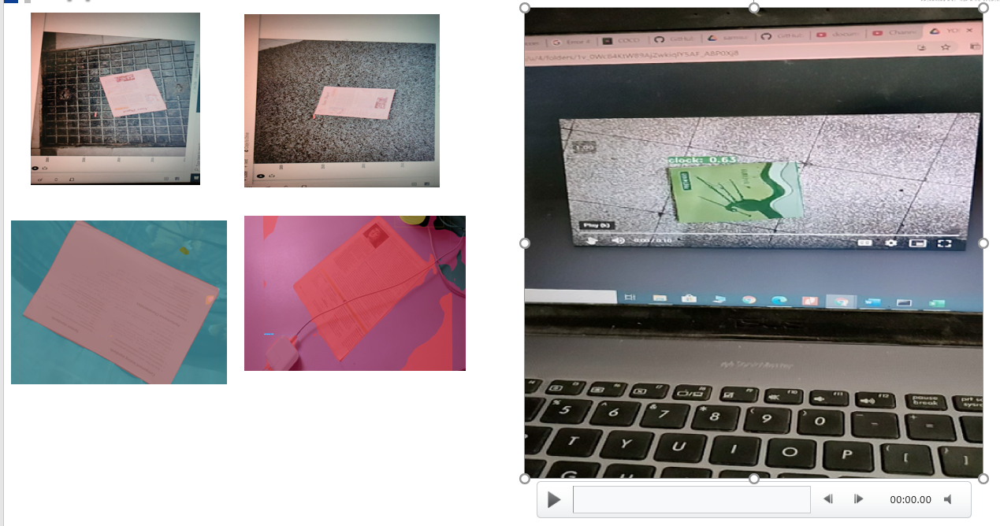
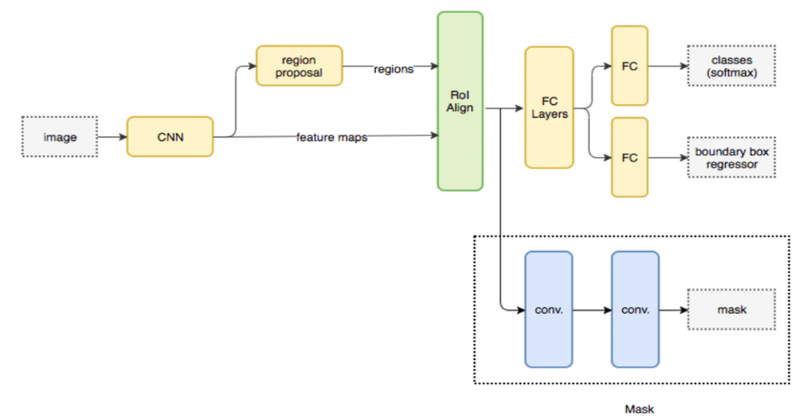
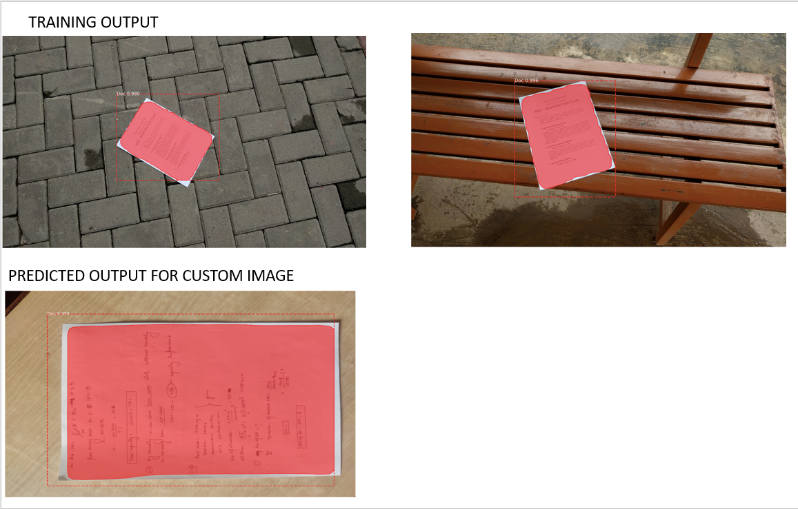
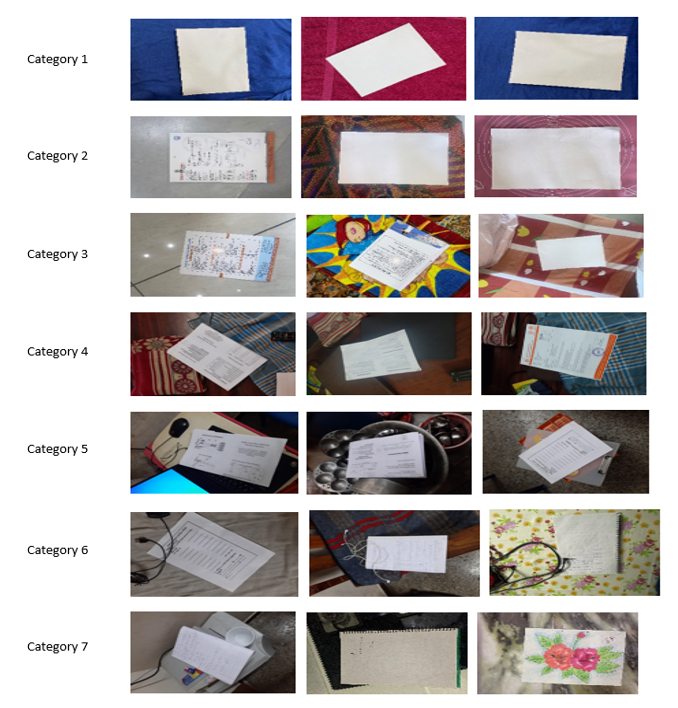
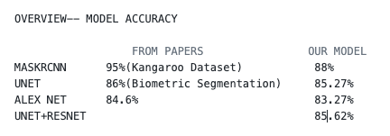

# VIT_VIG26VITC_RealTime_DL_Based_Document_Detection
## **SRIB-PRISM Program**

#### **Approach**
1. UNET Architecture.
- The architecture consists of 3 convolution layers in each stage followed by a max polling layers.
- The input image was of size 64X64X3.
- It has five stages for down sampling and up sampling.
- The accuracy of the model was 85%

2. UNET + RESNET
- When we add more layers to the model at some point the accuracy starts to saturate and can degrade. Hence, we decided to add skip connections to the model.
- The accuracy was 86%

3. ALEX NET (suggested by Samsung mentor)
- The architecture consists of convolution layer followed  activation layer and then maxpooling layers.
- Similar to UNET it has down sampling and up sampling.
- The accuracy of the model was 83%.

4. YOLACT++
- Get sample test images from coco dataset.
- Get pretrained weights(resnet50)
- Run inference on the test images.
- We check on test video with documents.
*Limitation*
- We could not train with custom dataset so we moved to mask RCNN.
- 

5. **MaskRCNN**
- 
- 

### **DATASET**
- 
- 261 custom images(4k X 5k ) – link- https://drive.google.com/drive/u/1/folders/1IfbrXkCPeXhIrRTATqPdcYY8alpWwvCw     (Samsung galaxy A50, iPhone 11)
- 14,208 images(64 X 64) - https://drive.google.com/file/d/1IRZhAAux3kYi5ZfkFxVU6Djux3tF6LOj/view?usp=sharing
- SmartDoc Competition 2 dataset : https://sites.google.com/site/icdar15smartdoc/challenge-1/challenge1dataset
- Khurramjaved - collected dataset (112): https://drive.google.com/drive/folders/0B9Sr0v9WkqCmekhjTTY2aV9hUmM?usp=sharing

